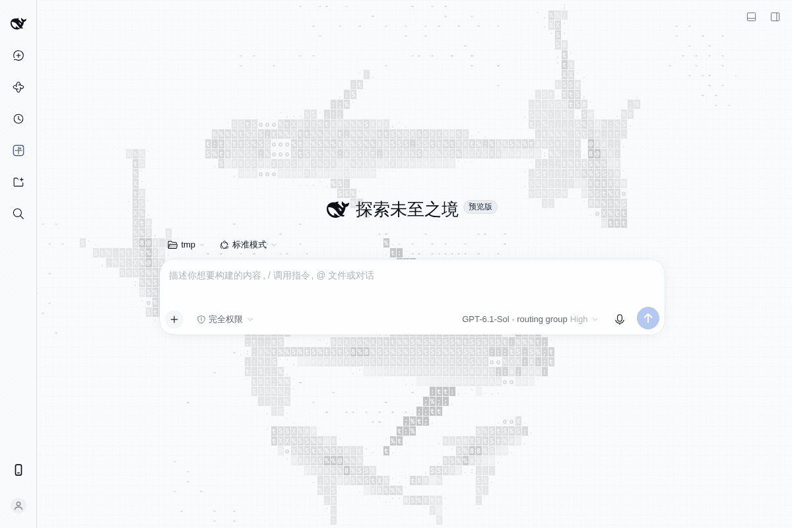
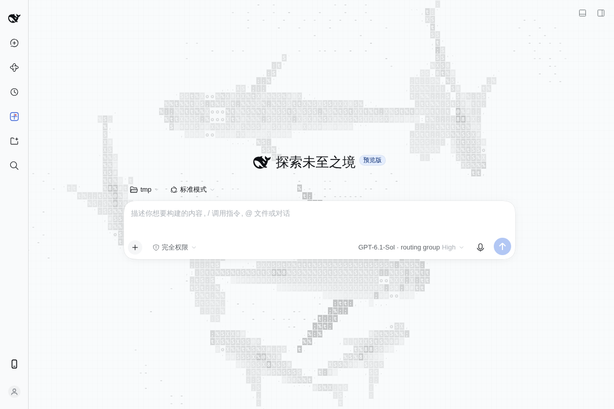

# dsh-ascii-sharks

## 来源与许可 / Attribution

本项目基于 **[stackedlol/ascii-sharks](https://github.com/stackedlol/ascii-sharks.git)** 开发，保留原始 Git 历史和 [MIT 许可证](LICENSE)。原始代码版权归许可证中列明的作者 drewdi 所有。

This project is derived from [stackedlol/ascii-sharks](https://github.com/stackedlol/ascii-sharks.git). The original Git history, copyright notice, and MIT license are preserved.

## 专门用于 DSH 的 ASCII 鲨鱼背景

为 **DeepSeek Harness（DSH）Web 界面**添加持续游动的 ASCII 鲨鱼背景。鲨鱼、鱼群、座头鲸和蓝鲸在界面底层缓慢游动，保留聊天输入框、菜单和侧栏的原有表面与操作方式。

### DSH 实机演示

下方 GIF 录制自已加载此插件的真实 DSH 页面，展示浅色和深色效果。录制时收起侧栏，在空白新会话首页展示背景。



<details>
<summary>静态预览（不播放动画）</summary>



</details>

### 背景效果

- 默认包含四条鲨鱼、一条座头鲸、一条蓝鲸和小鱼群。
- 浅色主题使用淡灰色轮廓，深色主题使用低亮度蓝灰色，适合作为界面底层背景。
- 背景不接收鼠标和触摸事件，输入框、按钮、菜单和侧栏照常使用。
- 渲染上限为 30 fps、DPR 1；页面隐藏时暂停，遵循系统的“减少动态效果”偏好。
- 通过独立 DSH 插件加载，卸载时清理画布、样式、动画和主题覆盖。

## 安装到 DSH

需要支持 Web 客户端插件和主题服务的 DSH 环境。仓库已包含构建好的背景产物，首次安装可直接加载。

```sh
git clone https://github.com/A-Lucious/dsh-ascii-sharks.git
cd dsh-ascii-sharks
```

在 DSH Web 配置补丁（通常为 `~/.dsh/profiles/web/cordis.patch.yml`）的顶层补丁列表中加入以下条目。将 `/absolute/path/to/dsh-ascii-sharks` 替换为本仓库的实际绝对路径：

```yaml
- insert:
    - id: ascii-ocean-background
      name: /absolute/path/to/dsh-ascii-sharks/dsh-background/host.js
      disabled: false
```

让 DSH 重新加载插件配置，再刷新现有 DSH 页面。背景随 DSH 客户端加载，无需运行 Vite 演示服务。

### 关闭背景

将上面的 `disabled` 改为 `true`，或移除该条目，然后重新加载配置。插件卸载后恢复原有基础背景，保留用户的主题偏好。

## 修改与构建

背景入口是 [`dsh-background/client.ts`](dsh-background/client.ts)。默认动物种类与大小在 `RESIDENTS` 中配置，浅色、深色与窄屏透明度在同文件的 CSS 中调整。共享动画引擎位于 [`src/`](src/)。

```sh
npm ci
npm exec -- tsc --noEmit -p dsh-background/tsconfig.json
node scripts/build-dsh-background.mjs
```

构建会更新 `dsh-background/client.js`。更新已加载的插件后，需要让 DSH Host 重新读取客户端产物，再刷新页面；可使用 DSH 的重建通知机制，或重启对应 Host。仅刷新浏览器不会让 Host 重新读取已缓存的旧产物。

### 本地验证

```sh
npm run typecheck
npm run build
node scripts/verify-whales.mjs
```

模拟检查覆盖八种鲨鱼、两种鲸鱼以及窄屏缩放。需要在本地独立查看动画时，可运行 `npm run dev`；这只是开发预览入口，DSH 背景本身无需依赖它。

[`scripts/verify-dsh-background.mjs`](scripts/verify-dsh-background.mjs) 提供面向本地 DSH 环境的集成验证参考，需要按本机地址、认证方式和界面内容配置。

## 许可

[MIT](LICENSE)。使用、修改或分发时请保留原许可证和版权声明。
